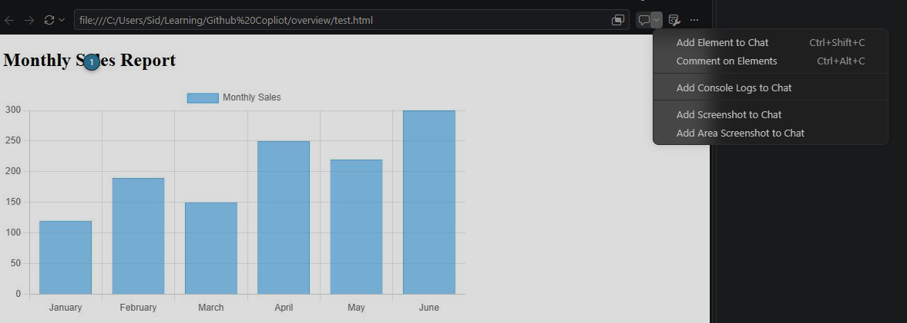
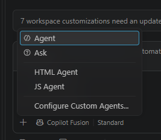

<!--
Author: Sid
Modification date: 2026-11-27 23:23:01 +05:30
-->

# Learning GitHub Copilot 🤖

GitHub Copilot is an AI-powered coding assistant that can help with debugging, writing, and understanding code.

## Features ✨

1. **Code completion**
2. **Agent mode:** Updates or creates files based on your request.
3. **Plan mode:** Plans the steps needed to complete a task.

## Copilot Modes 🎛️

1. **Agent:** Updates files, runs scripts, and creates files.
2. **Ask:** Answers questions.
3. **Plan:** Plans the steps needed to complete a task.
4. **Code completion:** Uses the context, comments, and open tab to suggest the next snippet.

Each mode provides certain tools by default, which determine the responses or edits it can make. You can add or remove tools, but those changes apply only to that session.

For example, Ask mode does not have the edit tool, while Agent mode does.

## Integrated Browser for UI Work 🌐

When working on UI changes, GitHub Copilot in VS Code has an integrated browser with these options:



1. **Add an element to chat:** Select an element and ask Copilot to modify it.
2. **Comment on an element:** Select an element and add a comment with modification instructions.
3. **Add console logs to chat:** Check the UI console and fix any errors.
4. **Add a screenshot to chat:** Add a screenshot of the whole page for context.
5. **Add an area screenshot to chat:** Select a specific area and add it as a screenshot for context.

## Copilot Concepts

| Feature | What it does |
| --- | --- |
| Prompts | Give Copilot a task |
| Instructions | Tell Copilot how it should behave |
| Skills | Provide reusable knowledge and workflows |
| Hooks | Execute scripts automatically at specific events |
| Tools | Allow Copilot to perform operations |
| MCP | Connect Copilot to external systems and services |

## Instructions (Rule Book) 📋

Instructions are custom guidelines that tell GitHub Copilot how to understand, write, modify, and maintain code in a project.

For example:

- Use a pink background for all buttons.
- Follow the existing folder pattern and naming conventions.
- Use functional components.

Write these rules in a Markdown file. They are always added to the context, so you do not need to mention them explicitly.

You can have a common instruction file in either of these locations:

- `.github/copilot-instructions.md` — Specific to GitHub Copilot.
- `AGENTS.md` — For AI agents such as Claude, Copilot, and Gemini. They refer to this file by default and then check for specific files such as the one above.

You can also have path-specific or topic-specific instruction files, such as:

- `.github/instructions/frontend.instructions.md`
- `.github/instructions/backend.instructions.md`

## Slash Commands and Prompts

Slash commands are predefined prompts or shortcuts for common tasks, such as `/explain` or `/test`.

You can create your own slash command or prompt by creating a file inside:

`.github/prompts/addFileNameComment-prompt.md`

To invoke it:

```text
/addFileNameComment #script.js
```

This adds the file name as a comment in the file itself. `#` is used to reference the file.

## Hooks 🪝

Hooks are automated actions that run when a particular event occurs during an AI agent's workflow. You can configure a script to run for workflow events such as `postToolUse` or `sessionStart`.

For example, a hook can add this comment to the top of the README after a tool is used to modify it:

```text
Author: Sid
Modification date: {date-and-time}
```

Using `/create-hook`, I created a hook that added these two files:

- `.github\hooks\readme-modification.json`
- `.github\hooks\scripts\add-readme-modification-comment.cjs`

It also updated the author and modification date at the top of the README.

## Agents 🤝

Unlike Copilot Chat, an agent does more than provide an answer: it can help implement tasks through commands, file creation, code generation, and bug fixes.

There are mainly three modes of agents:

1. **Local agent (Agent mode in Copilot):** The agent you use in the IDE to make changes.
2. **Background agent:** You can delegate a task to a background agent while you work on another task in the IDE.
3. **Cloud agent:** You can delegate a task on GitHub.com. It creates an agent, assigns the task, makes changes in a new branch, and raises a pull request.

You can create your own custom agent with specific tools so it works in a more efficient and controlled way. You can set an agent in a custom prompt and invoke that prompt in chat, or use the agent directly for a task.

A custom agent can include details such as:

```md
Name: name of the agent
desc: what it can do
tools: [tools it can use]

test desc

security desc

formatting desc
etc...
```

Here, I have created two simple agents, HTML and JS. They are available in the agent section and can be used to perform tasks.



**Note:** You can assign code reviews, issues, or tasks directly to Copilot via `@copilot`.

If you have multiple independent tasks and do not want to overload the context of the agent working on another task, you can ask Copilot to use the subagent tool. It spawns separate agents to do those tasks with less context.
